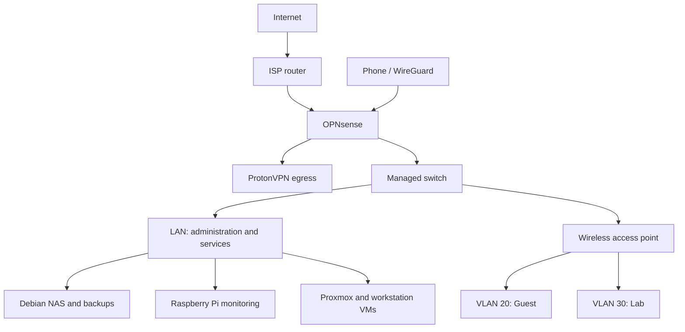

# HNIC Homelab

**A practical portfolio of networking, system administration and troubleshooting by Fortune Kuzwayo / CyberHnic.**

I built this lab to practise the work behind reliable IT services: segmentation, VPN routing, remote access, storage, automated backups and monitoring. The most valuable projects include diagnosing faults and checking the result after a reboot.

## Architecture

Conceptual topology: VPN routing is policy based; this diagram does not assert that every device uses the tunnel. Physical uplinks and current firewall rules should be checked against the live configuration.

## Project case studies

| Project | Outcome | Documentation |
| --- | --- | --- |
| OPNsense and VLANs | Built separate LAN, Guest and Lab networks and resolved connectivity problems | [Network segmentation](docs/network-segmentation.md) |
| ProtonVPN routing recovery | Restored VPN egress and verified persistence after reboot | [Routing incident](docs/protonvpn-routing.md) |
| WireGuard | Established phone connectivity to home services | [Remote access](docs/wireguard.md) |
| NAS and backups | Deployed SMB storage and a daily rsync backup timer | [Storage operations](docs/storage-backups.md) |
| Monitoring | Deployed service checks and repaired SMART monitoring permissions | [Monitoring](docs/monitoring.md) |
| VM integration | Established SSH, DNS and shared-storage access for Windows and Ubuntu | [VM integration](docs/vm-integration.md) |

## Evidence and scope

These case studies summarize results recorded during my lab work in August–October 2026. Raw command output and screenshots are not included in this initial release. Historical checks demonstrate the state at the time of testing; they do not establish current service health.

The documents distinguish completed checks from validation still to collect. Exact deployed scripts and firewall exports are not included. Reproduction requires adapting settings to the target environment.

## Hardware and software

- OPNsense firewall, Zyxel managed switch and TP-Link Omada access point.
- Intel NUC running Debian, with external storage and a separate backup drive.
- Raspberry Pi running Debian and Uptime Kuma in Docker.
- Proxmox host and a Mac workstation with Parallels Windows/Linux VMs.
- OPNsense VPN routing, WireGuard, Monit, SMART, rsync, systemd, SSH and SMB.

## Documentation roadmap

- Capture sanitized configuration examples and dated command output.
- Verify backup restoration into a temporary directory.
- Document Guest-to-LAN isolation with explicit allowed and denied tests.
- Record a controlled VPN outage test for the kill switch.
- Add Grafana dashboard documentation after checking queries and alert behavior.

## Public repository hygiene

Examples omit public endpoints, device identifiers, account passwords, API tokens and VPN private keys. Review screenshots, exports and Git history before publishing. Use placeholders for environment-specific settings.
