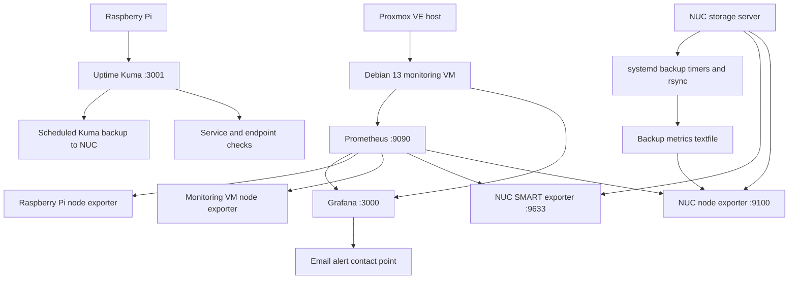

# projects/monitoring/README.md

> **Practical Linux, networking and cybersecurity project** — Debian 13, Proxmox VE, Prometheus, Grafana, Raspberry Pi, Uptime Kuma, SMART monitoring, systemd and rsync.

**Project status:** Operational; email contact point tested successfully on 11 October 2026.  
**Author:** [CyberHnic](https://github.com/CyberHnic)  
**Companion project:** [HNIC Homelab](https://github.com/CyberHnic/Hnic-Homelab)

## Overview

This project documents how I built a monitoring and alerting environment for my homelab. It combines **metrics-based monitoring** (Prometheus and Grafana) with **service availability checks** (Uptime Kuma). I also expose backup completion timestamps as Prometheus metrics, making failed or overdue backups visible rather than relying only on scheduled jobs.

This repository is a **sanitized technical case study and learning guide**, not a dump of production configuration. Exact deployment files and recovery secrets remain private.

## Learning objectives

After studying or reproducing this project in a test environment, you should be able to:

1. Explain the difference between service uptime checks, metrics collection, visualization and alerting.
2. Describe Prometheus's pull/scrape model and interpret `up`, `job` and `instance` labels.
3. Deploy and inspect a Docker Compose monitoring stack on a Debian VM.
4. Configure Linux exporters and limit access to monitoring ports using host firewall rules.
5. Write PromQL expressions for SMART failures, missing metrics and backup age.
6. Build Grafana Stat panels with units, legends and meaningful thresholds.
7. Configure alert evaluation, pending periods, No Data behavior and notification contact points.
8. Use systemd timers, rsync and exporter textfiles to monitor backup freshness.
9. Troubleshoot DNS, connectivity, exporter health, missing data and email delivery.
10. Document verification evidence and develop a safe recovery plan.

## Architecture



The diagram is logical; it does not imply that all services run in the same container or that every arrow represents an inbound connection.

## Environment

| Component | Role | Deployment |
|---|---|---|
| Proxmox VE | Virtualization host | Homelab LAN |
| Debian 13 monitoring VM | Prometheus, Grafana and node exporter | Docker Compose |
| NUC Debian 13 storage server | Storage, SMART metrics, backup jobs | Native systemd services |
| Raspberry Pi | Uptime Kuma and node exporter | Docker Compose / native exporter |
| OPNsense | Firewall and network segmentation | Dedicated firewall |

**Example lab addresses:** monitoring `10.10.10.156`, NUC `10.10.10.185`, Raspberry Pi `10.10.10.69`. These are private RFC1918 addresses, provided for topology illustration only; replace them in your own lab.

## Part 1 — Prometheus and Grafana

The monitoring VM hosts a Compose stack with:

- **Grafana:** dashboards and alert management (`:3000`)
- **Prometheus:** metric collection and PromQL (`:9090`)
- **Node exporter:** Linux host resource metrics (`:9100`)

Prometheus scrapes jobs for the monitoring server, Raspberry Pi, NUC node exporter and NUC SMART exporter. The NUC's exporter ports are restricted by its host firewall to the monitoring VM.

### Verify metrics

Run these queries in Prometheus or Grafana Explore:

```promql
up{job="nuc-storage"}
up{job="nuc-smart"}
smartctl_device_smart_status{job="nuc-smart"}
smartctl_device_temperature{job="nuc-smart",temperature_type="current"}
```

Expected in a healthy lab: `up` returns `1`, SMART health returns `1` for reporting drives. Metric availability and device support vary by hardware.

### SMART dashboard

**NUC Storage — SMART Health** displays:

- SMART health for four detected drives: system SSD, T5 backup, critical backup and main storage.
- Drive temperatures with warning/critical thresholds at **45°C / 55°C** (project visualization thresholds, not manufacturer specifications).
- SMART attributes including reallocated sectors, pending sectors and offline uncorrectable errors, where reported.

A separate **Node Exporter Full** dashboard shows CPU, memory, swap, network and filesystem utilization. **NUC Backup Monitoring** shows the age of the two backup jobs.

## Part 2 — Alert rules

| Grafana alert | Query / condition | Purpose |
|---|---|---|
| NUC - SMART Disk Failure | `smartctl_device_smart_status{job="nuc-smart"} == bool 0` → above `0` | Disk reports failing SMART status |
| NUC - SMART Exporter Down | `up{job="nuc-smart"}` → below `1` | Prometheus cannot scrape the exporter |
| NUC - SMART Disk Missing | `count(smartctl_device_smart_status{job="nuc-smart"}) or vector(0)` → below `4` | Fewer than four SMART series present |
| NUC - Backup Overdue | `(time() - homelab_backup_last_success_timestamp_seconds{job="nuc-storage"}) / 3600` → above `26` | Last successful backup is over 26 hours old |

**Alert design notes:** The SMART exporter and disk-count rules address different failure modes. A query can return no series when a target disappears; the configured **No Data** behavior therefore matters. The count query uses `or vector(0)` to keep an explicit zero when the source metric is absent. The expected count of four is specific to this NUC and must be changed if the disk inventory changes.

The alerts are stored under Grafana's **Homelab Alerts** folder and sent to the **Homelab Email Alerts** contact point. A test email was delivered successfully; real-world incident delivery has not been deliberately induced.

## Part 3 — Backup automation and monitoring

The NUC runs two independent daily backups:

| Job | Schedule | Source | Destination |
|---|---|---|---|
| T5 backup | 03:00 | `/srv/storage/` | `/mnt/t5-backup/storage-backup/` |
| Critical backup | 04:00 | `/srv/storage/Critical/` and `/srv/storage/Homelab-Configs/` | `/mnt/critical-backup/` |

Both use `rsync -aHAX`, `--numeric-ids`, delayed deletion, and archived previous versions. The scripts verify source and destination filesystem UUIDs before copying and use file locks to prevent overlapping runs.

A custom Python metrics script writes a Prometheus textfile under `/var/lib/prometheus/node-exporter/`. A systemd timer refreshes it every five minutes. The exporter exposes:

```promql
homelab_backup_last_success_timestamp_seconds{job="nuc-storage"}
```

Backup age in hours:

```promql
(time() - homelab_backup_last_success_timestamp_seconds{job="nuc-storage"}) / 3600
```

**Verification (11 October 2026):** T5 and critical backup services reported successful exits at 03:00 and 04:00; the dashboard showed fresh ages and the overdue alert was Normal. This confirms recent job completion, **not** a full restore test or proof of recoverability.

### Read-only Linux checks

```bash
systemctl list-timers --all | grep -Ei 'backup|homelab'
systemctl show t5-backup.service critical-backup.service \
  -p Id -p Result -p ExecMainStatus -p ExecMainExitTimestamp
systemctl status homelab-backup-metrics.timer --no-pager
curl -fsS http://localhost:9100/metrics | grep '^homelab_backup_'
```

## Part 4 — Uptime Kuma on Raspberry Pi

Uptime Kuma runs as a Docker container on a Raspberry Pi and is accessed over the homelab LAN at `http://10.10.10.69:3001`.

It complements Prometheus by answering a different question: **Can a user or monitor reach this service?** Appropriate monitors can include HTTP(S), TCP and ping checks for internal services. The exact active monitor inventory and notification settings should be exported from the running Kuma instance before claiming them as documented.

A scheduled systemd job backs up Kuma data to NUC storage. A previously verified run of `uptime-kuma-backup.service` completed successfully. The exact current script, destination and retention policy remain **to be captured and verified**.

### Read-only Pi checks

```bash
cd ~/uptime-kuma
docker compose ps
docker ps --filter name=uptime-kuma
systemctl list-timers --all | grep -i kuma
systemctl status uptime-kuma-backup.service --no-pager
journalctl -u uptime-kuma-backup.service -n 30 --no-pager
```

**Do not** publish Kuma database files, API tokens, notification credentials, webhook URLs or backup archives.

## Troubleshooting quick reference

| Symptom | First check | Next check |
|---|---|---|
| Prometheus target DOWN | `up{job="..."}` | Exporter process, DNS, firewall and listening port |
| SMART panel empty | `up{job="nuc-smart"}` | Exporter metrics, labels and Grafana query |
| Disk missing alert | Count SMART series | Physical disk, USB enclosure and exporter visibility |
| Backup age rising | `systemctl show ... -p Result` | `journalctl`, backup logs, destination mount |
| Backup metrics absent | `node_textfile_scrape_error` | Textfile permissions, script and timer |
| Kuma inaccessible | `docker compose ps` | Host IP, port 3001, VLAN rules, DNS |
| Email alerts not arriving | Grafana contact-point Test | SMTP settings, outbound connectivity and spam folder |

## Learning labs

1. **PromQL fundamentals:** Compare `up` values across jobs and explain every label.
2. **Disk observability:** Identify each drive and compare SMART status, temperature and filesystem use.
3. **Backup freshness:** Convert the last-success timestamp to hours and explain why the alert threshold is 26 hours.
4. **Failure reasoning:** Predict what each alert does if the exporter stops, one disk disappears, or a backup is missed. Do not disconnect production storage to test.
5. **Recovery planning:** Inventory Compose files, Grafana dashboard exports, Prometheus configuration, Kuma data and backup scripts; verify that protected copies exist.
6. **Documentation:** Record commands, expected output, observed output, date and any deviations.

## Security and publishing guidance

- Keep passwords, SMTP app passwords, private keys, tokens, Grafana session cookies and Kuma database files out of Git.
- Review screenshots for personal email addresses, private URLs and sensitive metadata.
- Restrict exporter ports to the monitoring host; do not expose Grafana, Prometheus or Kuma directly to the public Internet without an appropriate access-control design.
- Store private configuration backups separately from this public repository.
- Treat the PromQL and commands above as documented examples of this deployment, not universal production defaults.

## What remains to document from the live systems

- [ ] Export and sanitize actual `compose.yaml` and Prometheus scrape configuration.
- [ ] Export Grafana dashboards and alert-rule definitions.
- [ ] Capture the complete backup metrics Python script and timer units.
- [ ] Capture the exact Uptime Kuma Compose file, monitor list, notification settings and backup job.
- [ ] Perform and record a controlled restore test for both storage backups and Kuma.
- [ ] Add sanitized screenshots and an architecture diagram to `docs/`.

## Skills demonstrated

**Linux administration · Debian · Docker Compose · Proxmox · Prometheus · Grafana · PromQL · systemd · rsync · SMART · Monitoring · Alerting · Backup verification · Networking · Troubleshooting · Technical documentation**

---

*This is a learning and operations case study. All environment-specific configuration should be independently checked before reuse.*
